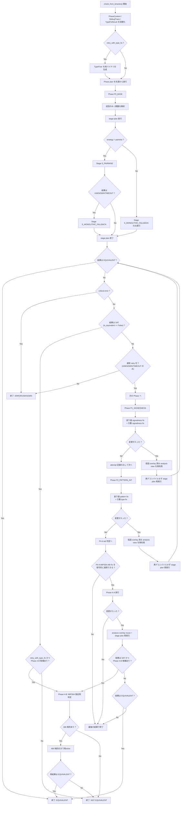
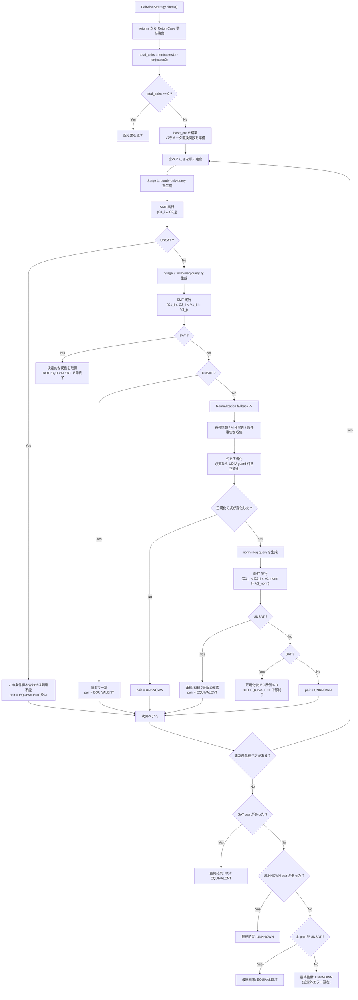
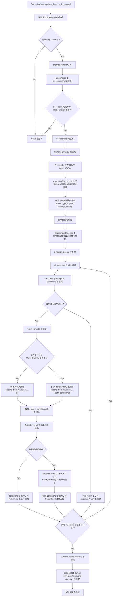

# Equivalence Flow Diagrams

リファクタリング後の実装に合わせて、等価性判定まわりの主要フローを mermaid で整理したものです。
対象コードは主に [checker.py](/mnt/c/Users/saito/Git/ghidra-docker-env/scripts/function_tracer_pcode/checker/checker.py), [workflow.py](/mnt/c/Users/saito/Git/ghidra-docker-env/scripts/function_tracer_pcode/checker/workflow.py), [handler.py](/mnt/c/Users/saito/Git/ghidra-docker-env/scripts/function_tracer_pcode/checker/phases/handler.py), [pairwise.py](/mnt/c/Users/saito/Git/ghidra-docker-env/scripts/function_tracer_pcode/proof/strategies/pairwise.py), [analyzer.py](/mnt/c/Users/saito/Git/ghidra-docker-env/scripts/function_tracer_pcode/analysis/returns/analyzer.py) です。

## 1. 全体フロー図（エンドツーエンド）

## 2. pairwise 戦略の内部フロー（1つの判定サイクル内）

補足:
P1/P2/P4-A の型修正 phase は Ghidra `Program` を更新しません。
各 phase は `FunctionReturnAnalysis` / `FunctionSignature` に仮説 overlay を重ね、
その effective analysis view を使って次の stage plan を再実行します。
そのため、retry 後に見ているのは「仮説を注入して永続変更した Program」ではなく、
「元 Program から得た解析結果に仮説コンテキストを重ねた view」です。

## 3. 「1回の関数解析」で何をしているか（判定前処理）

